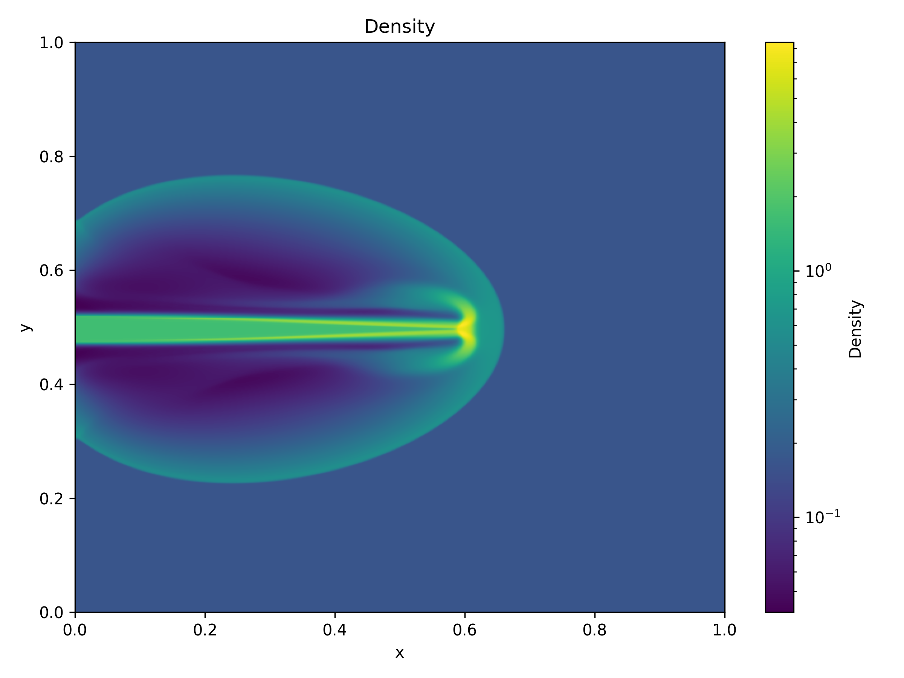
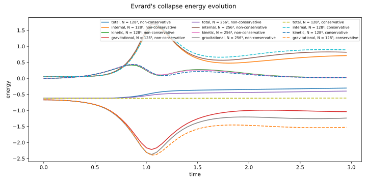

# astronomix - differentiable mhd for astrophysics in JAX

[](https://www.repostatus.org/#active)
[](https://doi.org/10.5281/zenodo.15052815)

`astronomix` (formerly `jf1uids`) is a differentiable hydrodynamics and magnetohydrodynamics code
written in `JAX` with a focus on astrophysical applications. `astronomix` is easy to use, well-suited for
fast method development, scales to multiple GPUs and its differentiability 
opens the door for gradient-based inverse modeling and sampling as well 
as surrogate / solver-in-the-loop training.

## Features

- [x] 1D, 2D and 3D hydrodynamics (HD) and magnetohydrodynamics (MHD), scaling to multiple GPUs and nodes
- [x] two finite-difference (FD) schemes of fifth order: WENO-JS / WENO-Z flux splitting with the constrained
  transport of [HOW-MHD (Seo & Ryu 2023)](https://arxiv.org/abs/2304.04360), with a positivity-preserving
  reconstruction (after [Zhang & Shu 2012](https://www.sciencedirect.com/science/article/pii/S0021999111006759)
  and [Wu 2018](https://arxiv.org/abs/1802.02278)) and an optional upwind dissipation of the edge electric
  fields; and a scheme with WENO face states, a Riemann flux (HLLEM-type for a barotropic gas, a bounded HLLD /
  HLLC for the ideal gas) and flux-form constrained transport
- [x] a re-implementation of [AthenaPK](https://github.com/parthenon-hpc-lab/athenapk)'s second-order finite-volume
  (FV) scheme (VL2 predictor-corrector, PLM, HLLD / HLLE / HLLC, GLM divergence cleaning or constrained transport,
  first-order flux correction), agreeing with AthenaPK to round-off
  ([validation](examples/scripts/validation/athenapk_vl2)); the same framework runs the unsplit RK2 and the
  split MUSCL-Hancock integrators, and the reference scheme of Beattie et al. (2025) (MUSCL-Hancock with the
  HLL5R solver of Bouchut, Klingenberg & Waagan, after Waagan, Federrath & Klingenberg 2011)
- [x] equations of state: ideal gas, isothermal and polytropic
- [x] physics modules in every scheme: self-gravity (with a semi-discretely energy-conserving coupling in the FD
  scheme) and external potentials, radiative cooling, thermal conduction, viscosity, resistivity, passive scalars,
  stellar winds, dual energy, and turbulence driving (a JAX port of
  [TurbGen](https://github.com/chfeder/turbulence_generator), Federrath et al.)
- [x] spherically symmetric 1D simulations that conserve mass and energy, following
  [Crittenden & Balachandar (2018)](https://doi.org/10.1007/s00193-017-0784-y)
- [x] forward and reverse differentiable, with adaptive time steps and checkpointing
- [x] Pallas (Triton) GPU kernels for every scheme, on one GPU or on a device mesh (`shard_map` with a halo
  exchange)
- [x] easily extensible, all code is open source

## Contents

- [Features](#features)
- [Installation](#installation)
- [Hello World! Your first astronomix simulation](#hello-world-your-first-astronomix-simulation)
- [Configuration: schemes and presets](#configuration-schemes-and-presets)
- [Equations of state](#equations-of-state)
- [Physics modules](#physics-modules)
- [Pallas kernels and device meshes](#pallas-kernels-and-device-meshes)
- [Examples for Getting Started](#examples-for-getting-started)
- [Showcase](#showcase)
- [Performance](#performance)
- [Frequently Asked Questions (FAQ)](#frequently-asked-questions-faq)
  - [How to store intermediate information during the simulation?](#how-to-store-intermediate-information-during-the-simulation)
  - [How to fit larger simulations into GPU memory?](#how-to-fit-larger-simulations-into-gpu-memory)
  - [What if my simulation crashes?](#what-if-my-simulation-crashes)
- [Documentation](#documentation)
- [Tests](#tests)
- [Citing astronomix](#citing-astronomix)

## Installation

`astronomix` can be installed via `pip`

```bash
pip install astronomix
```

Note that if `JAX` is not yet installed, only the CPU version of `JAX` will be installed
as a dependency. For a GPU-compatible installation of `JAX`, please refer to the
[JAX installation guide](https://jax.readthedocs.io/en/latest/installation.html).

## Hello World! Your first astronomix simulation

Below is a minimal example of a 1D hydrodynamics shock tube simulation using `astronomix`.

```python
import jax.numpy as jnp
from astronomix import (
    SimulationConfig, SimulationParams,
    get_helper_data, finalize_config,
    get_registered_variables, construct_primitive_state,
    time_integration
)

# the SimulationConfig holds static 
# configuration parameters
config = SimulationConfig(
    box_size = 1.0,
    num_cells = 101,
    progress_bar = True
)

# the SimulationParams can be changed
# without causing re-compilation
params = SimulationParams(
    t_end = 0.2,
)

# the variable registry allows for the principled
# access of simulation variables from the state array
registered_variables = get_registered_variables(config)

# next we set up the initial state using the helper data
helper_data = get_helper_data(config)
shock_pos = 0.5
r = helper_data.geometric_centers
rho = jnp.where(r < shock_pos, 1.0, 0.125)
u = jnp.zeros_like(r)
p = jnp.where(r < shock_pos, 1.0, 0.1)

# get initial state
initial_state = construct_primitive_state(
    config = config,
    registered_variables = registered_variables,
    density = rho,
    velocity_x = u,
    gas_pressure = p,
)

# finalize and check the config
config = finalize_config(config, initial_state.shape)

# now we run the simulation
final_state = time_integration(initial_state, config, params, registered_variables)

# the final_state holds the final primitive state, the 
# variables can be accessed via the registered_variables
rho_final = final_state[registered_variables.density_index]
u_final = final_state[registered_variables.velocity_index]
p_final = final_state[registered_variables.pressure_index]
```

You've just run your first `astronomix` simulation! You can continue with
the notebooks below and we have also prepared a more advanced use-case
(stellar wind in driven MHD tubulence) which you can
[](https://colab.research.google.com/drive/1Pg98IPGnoejaGvzmNNZiwmf1JnXwYAJH?usp=sharing).

## Configuration: schemes and presets

A simulation is set up by two containers: the `SimulationConfig` holds the static choices (they are part of the
compiled program), the `SimulationParams` the numbers that can change, and be differentiated, without a new
compilation (CFL number, end time, adiabatic index, floors, module coefficients). `finalize_config` checks a
configuration and derives the rest (ghost cells, boundary handling, backend).

The solver is chosen by `solver_mode` (`FINITE_DIFFERENCE`, the default, or `FINITE_VOLUME`) and its settings by
`solver_config`, an `FDSolverConfig` or an `FVSolverConfig` (left at `None`, `finalize_config` fills in the
default container of the mode and rejects a container of the other one). A preset is a complete container;
single settings are changed with `_replace`:

```python
from astronomix import (
    ATHENAPK_VL2, FINITE_VOLUME, HLLC, SimulationConfig,
)

config = SimulationConfig(
    solver_mode=FINITE_VOLUME,
    solver_config=ATHENAPK_VL2._replace(riemann_solver=HLLC),  # hydrodynamics
    dimensionality=3,
    num_cells=128,
)
```

| Preset | Mode | Scheme | Use with |
|---|---|---|---|
| `FD_PAPER` | `FINITE_DIFFERENCE` | WENO-Z flux splitting, SSPRK(5,4), HOW-MHD constrained transport with the upwind dissipation of the edge fields | ideal gas, isothermal or polytropic; `C_cfl` up to 1.5; add `weno_positivity_preserving=True` at Mach numbers of two and above |
| `FD_RIEMANN_ISOTHERMAL` | `FINITE_DIFFERENCE` | WENO face states, HLLEM-type Riemann flux, SSPRK(3,3), flux-form constrained transport | `ISOTHERMAL` or `POLYTROPIC`, MHD in 3D or hydrodynamics in 1D to 3D; `C_cfl = 1.0` |
| `FD_RIEMANN_IDEAL_GAS` | `FINITE_DIFFERENCE` | the same with the bounded HLLD flux (HLLC in hydrodynamics) and SSPRK(5,4) | `IDEAL_GAS`; `C_cfl = 1.0` |
| `ATHENAPK_VL2` | `FINITE_VOLUME` | VL2, van Leer-limited PLM, HLLD, GLM cleaning, first-order flux correction | `riemann_solver=HLLC` for hydrodynamics; `C_cfl = 0.3` in 3D, `glm_alpha = 0.1` |
| `BEATTIE_REFERENCE` | `FINITE_VOLUME` | the scheme of Beattie et al. (2025): split MUSCL-Hancock, HLL5R, Powell term in the induction equation, parabolic cleaning | `ISOTHERMAL`, `mhd=True`; `C_cfl = 0.8` |

The options of the containers (time integrators `SSPRK54`, `SSPRK33`, `LSRK4` for FD and `RK2_SSP`,
`MUSCL_HANCOCK`, `VL2` for FV; limiters; Riemann solvers; divergence control `GLM`, `CONSTRAINED_TRANSPORT`,
`INDUCTION_SOURCE`) are documented field by field in
[`simulation_config.py`](astronomix/option_classes/simulation_config.py). Physics modules have containers of their
own (`gravity_config`, `diffusion_config`, `passive_scalar_config`, `wind_config`, `cooling_config`,
`turbulence_driving_config`), as do the positivity safeguards (`positivity_config`) and the backend
(`backend_config`). Scripts written for the configuration before these containers are migrated by
[`tools/migrate_config.py`](tools/migrate_config.py); see the [migration note](docs/source/migration.md).

## Equations of state

`equation_of_state` is `IDEAL_GAS` (the default; `gamma` in the parameters), `ISOTHERMAL` (`p = c_s^2 rho`,
`isothermal_sound_speed`) or `POLYTROPIC` (`p = K rho^Gamma`, `polytropic_constant` and `polytropic_exponent`).
The isothermal and the polytropic gas are one barotropic law in the code: the state has no energy variable. Both
FD schemes carry it (with their kernels); the FV integrators carry it with the Riemann solvers that need no energy
jump (`HLL`, `LAX_FRIEDRICHS`, `HLL5R`), so `ATHENAPK_VL2` with HLLD or HLLC is an ideal-gas scheme (the paper runs
it with `gamma = 1.0001` for a nearly isothermal gas), and `BEATTIE_REFERENCE` runs the isothermal and the ideal
gas. A polytropic exponent of one reproduces the isothermal gas to round-off.

## Physics modules

The modules run in every scheme family where they apply (a barotropic gas has no energy equation, so the modules
that act on the energy need the ideal gas; `finalize_config` says which combination it rejects). Explicit sources
and diffusive fluxes enter the stages of the integrator (one function, `_modules/_explicit_sources.py`),
operator-split updates run once per step after the solver (`_modules/_per_step_updates.py`).

- self-gravity (`GravityConfig(self_gravity=True)`, FFT Poisson solver; periodic or isolated boundaries) and
  external potentials;
- radiative cooling (`CoolingConfig`: power-law and piecewise power-law curves, tables, explicit or implicit
  update);
- thermal conduction, viscosity and resistivity (`DiffusionConfig`; the coefficients are parameters);
- passive scalars (`PassiveScalarConfig(num_scalars=...)`, optionally bounded, advected with their own
  sub-steps);
- stellar winds (`WindConfig`; in 3D in every scheme, on the spherical 1D grid in finite volume);
- turbulence driving (`TurbulenceDrivingConfig(turbulence_driving=True)` with
  `SimulationParams(turbulence_driving_params=TurbulenceDrivingParams(velocity=...))`): a port of TurbGen
  (Ornstein-Uhlenbeck modes with band, parabola or power-law spectra, solenoidal weight, automatic amplitude
  adjustment) that runs on the GPU inside the time loop without host round trips.

## Pallas kernels and device meshes

`BackendConfig(backend=...)` selects `NATIVE_JAX` (array form), `PALLAS` (fused GPU kernels) or
`OPTIMAL_BACKEND` (the default: Pallas on GPUs of compute capability 8.0 and above, the array form otherwise).
The kernels give the results of the array form to round-off and carry their own derivatives where reverse mode
needs them. `pallas_block_shape` sets the block of a kernel (a power of two that divides the padded grid);
`pallas_interpret=True` runs the kernels in the interpreter on the CPU (for tests).

For several GPUs, put the state on a device mesh and hand the sharding to `time_integration`:

```python
mesh = jax.make_mesh((1, 2, 2, 1), (VARAXIS, XAXIS, YAXIS, ZAXIS))
sharding = NamedSharding(mesh, PartitionSpec(VARAXIS, XAXIS, YAXIS, ZAXIS))
state = jax.device_put(initial_state, sharding)
final_state = time_integration(state, config, params, registered_variables, sharding=sharding)
```

Every kernel then runs on the local block of each device inside a `shard_map`, with a halo exchange between
neighbouring devices; the array form is partitioned by XLA. See
[`examples/scripts/multi_gpu`](examples/scripts/multi_gpu) for building a large initial state directly on the
devices and for runs over several nodes.

## Examples for Getting Started

Runnable scripts live under `examples/scripts/`, notebooks under
`examples/notebooks/`.

- forward simulations
  - [1D Sod shock tube](examples/scripts/forward/hydro/shock_tube.py), [a minimal notebook](examples/notebooks/hydro/simple_example.ipynb)
  - [2D Kelvin-Helmholtz instability](examples/scripts/forward/hydro/khi.py) ([notebook](examples/notebooks/hydro/kelvin_helmholtz.ipynb))
  - [2D Orszag-Tang vortex](examples/scripts/forward/mhd/orszag_tang.py) ([notebook](examples/notebooks/mhd/orszag_tang_vortex.ipynb))
  - [3D MHD jet](examples/scripts/forward/mhd/jet.py) ([notebook](examples/notebooks/mhd/jet.ipynb))
  - [3D driven MHD turbulence and the small-scale dynamo](examples/scripts/forward/mhd/turbulence) (astronomix against AthenaPK)
  - [3D self-gravitating collapse](examples/scripts/forward/self_gravity/collapse.py) ([notebook](examples/notebooks/gravity/evrards_collapse.ipynb))
- differentiability
  - [Field-level inference](examples/scripts/differentiability/field_level_inference) ([notebook](examples/notebooks/differentiability/field_level_inference.ipynb))
  - [KHI eigenmode initialization](examples/scripts/differentiability/eigen_initialization.py)
  - [Solver-in-the-loop correction network](examples/scripts/differentiability/solver_in_the_loop.py)
- output options
  - [On-the-fly movie via callback](examples/scripts/output_options/callback.py)
  - [Orbax checkpointing and restart](examples/scripts/output_options/orbax_checkpointing.py)
  - [In-memory snapshot diagnostics](examples/scripts/output_options/return_snapshots.py)
- multi-GPU
  - [Sharded multi-GPU run](examples/scripts/multi_gpu/multi_gpu.py)
  - [Multi-node run](examples/scripts/multi_gpu/multi_node.py)
- validation
  - [AthenaPK's VL2 scheme in astronomix](examples/scripts/validation/athenapk_vl2)
  - [Positivity-preserving WENO](examples/scripts/validation/weno_stability)

More involved, physics-module showcase scripts — turbulent radiative mixing
layer, stellar wind, cooling — live in [`examples/gallery/`](examples/gallery).

## Showcase

|  |
|:---------------------------------------------------------------------------------:|
| Magnetohydrodynamics simulation with driven turbulence at a resolution of 512³ cells in a fifth order CT MHD scheme run on 4 H200 GPUs. |

|  |
|:---------------------------------------------------------------------------------:|
| Magnetohydrodynamics simulation with driven turbulence and stellar wind at a resolution of 512³ cells in a fifth order CT MHD scheme run on 4 H200 GPUs. |

|  |
|:----------------------------------------------------------:|
| 3D MHD jet propagating into a magnetized medium. |

|  |
|:-----------------------------------------------------------------------------------------------------------:|
| Novel semi-discretely energy conserving self-gravity scheme. |

## Performance

Methods paper incoming :)

## Frequently Asked Questions (FAQ)

### How to store intermediate information during the simulation?

There are two main options for storing intermediate states:

- activate `return_snapshots` in the `SimulationConfig`, set either `num_snapshots` in the `SimulationConfig` for equidistant snapshots or `snapshot_timepoints` in the `SimulationParams` for custom snapshot timepoints, then activate specific variables to be stored via `snapshot_settings` in the `SimulationConfig` (e.g. the full states, the total energy, ..., see [here](https://astronomix-mhd.web.app/source/astronomix.option_classes.simulation_config.html#astronomix.option_classes.simulation_config.SnapshotSettings)) - these snapshots are stored on the GPU directly, which avoids host-device transfer and is e.g. very useful for losses over intermediate states
- activate `activate_snapshot_callback` in the `SimulationConfig` and provide a callable as `snapshot_callable` to the `time_integration` function which is called at the same timepoints as the snapshots in the first option, this function can then offload specific data (possibly after processing) to the host via `jax.debug.callback` and save it appropriately (e.g. directly make plots, save to disk in the preferred format, ...); for long runs, `snapshot_storage_mode=TO_DISK` streams the snapshots to disk

### How to fit larger simulations into GPU memory?

Make sure that you only have the initial state in GPU memory when you start the simulation,
e.g. have a function which constructs the initial state (otherwise e.g. the intermediate helper data
you used to construct the state might still be in GPU memory). To further save storage,
you can donate the initial state to the time integration (activate `donate_state` in the `SimulationConfig`),
which allows `JAX` to reuse the same memory for the state throughout the simulation (but you can also no
longer access the initial state after the simulation has started).

### What if my simulation crashes?

First of all check if the initial conditions are valid. For the finite
difference scheme with flux splitting, turn on the positivity-preserving WENO
reconstruction (`FDSolverConfig(weno_positivity_preserving=True)`), which keeps
density and pressure positive for `C_cfl <= 0.75`. The `PositivityConfig` in
the `SimulationConfig` additionally offers a per-step density / pressure floor
and a retry of a step with a smaller time step (`step_retry=True`).

## Documentation

See [here](https://astronomix-mhd.web.app/). Users of the configuration before `solver_config` (version 0.6 and
earlier) find what was renamed or moved in the [migration note](docs/source/migration.md).

## Tests

`pytest` from the repository root runs the test suite in one process (`pytests/`, 442 tests, on a CPU with
`JAX_PLATFORMS=cpu` in about 11 minutes); the 121 tests that take 20 s or more on the CPU are marked `slow` and
run with `pytest -m ""`. Tests that need a GPU or several devices are skipped without them (with
`JAX_PLATFORMS=cpu` the CPU is split into four devices). The paper figures are regenerated by
`pytest pytests/test_reproduce_paper.py --reproduce-paper` (GPU, hours).

## Citing astronomix

If you use `astronomix` in your research, please cite via

```bibtex
@misc{storcks_astronomix_2025,
  doi = {10.5281/ZENODO.17782162},
  url = {https://zenodo.org/doi/10.5281/zenodo.17782162},
  author = {Storcks, Leonard},
  title = {astronomix - differentiable MHD in JAX},
  publisher = {Zenodo},
  year = {2025},
  copyright = {MIT License}
}
```

There is also a workshop paper on an earlier stage of the project:

[Storcks, L., & Buck, T. (2024). Differentiable Conservative Radially Symmetric Fluid Simulations and Stellar Winds--jf1uids. arXiv preprint arXiv:2410.23093.](https://arxiv.org/abs/2410.23093)