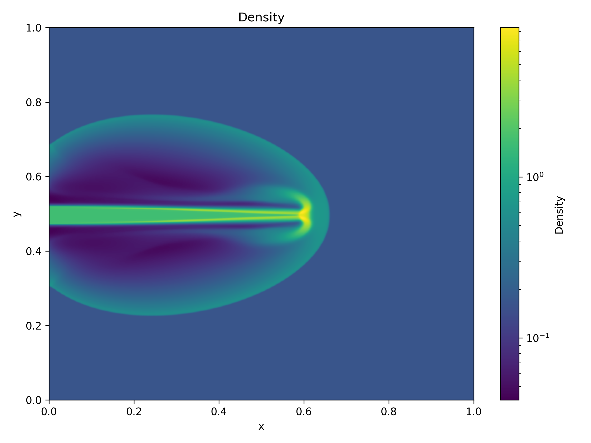
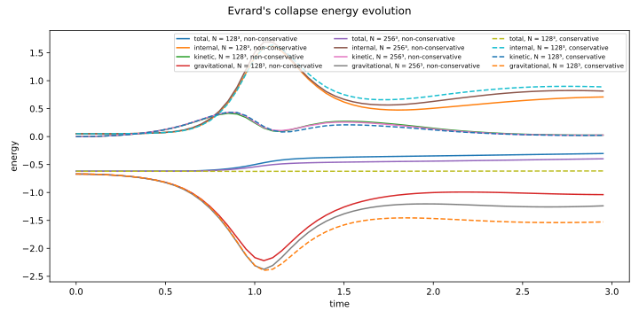

# Introduction and Installation

```{toctree}
:hidden:
:maxdepth: 2
:caption: Introduction

self
configuration
migration

```

`astronomix` - differentiable (magneto)hydrodynamics (MHD) for astrophysics written in `JAX`.


::::{grid} 1 2 2 3
:gutter: 1 1 1 2

:::{grid-item-card} {octicon}`zap;1.5em;sd-mr-1` Fast and Differentiable

`astronomix` is fully differentiable and scales to multiple GPUs and nodes.

:::

:::{grid-item-card} {octicon}`shield-check;1.5em;sd-mr-1` Well-considered Numerical Methods

Fifth-order finite-difference schemes (WENO flux splitting with the constrained transport of [HOW-MHD by Seo & Ryu 2023](https://arxiv.org/abs/2304.04360), and WENO face states with a Riemann flux), AthenaPK's second-order finite-volume scheme and the reference scheme of Beattie et al. (2025), with a semi-discretely energy-conserving self-gravity scheme; see [the configuration](configuration.md).

:::

:::{grid-item-card} {octicon}`tools;1.5em;sd-mr-1` Extensible

Physical modules for stellar winds, turbulent driving, ... can be activated or easily implemented. These modules can include parameters (or neural network terms) which can be optimized directly in the solver.

:::

::::

## Installation

`astronomix` can be installed via `pip`

```bash
pip install astronomix
```

Note that if `JAX` is not yet installed, only the CPU version of `JAX` will be installed
as a dependency. For a GPU-compatible installation of `JAX`, please refer to the
[JAX installation guide](https://jax.readthedocs.io/en/latest/installation.html).

## Hello World! Your first astronomix simulation

Below is a minimal example of a 1D hydrodynamics shock tube simulation using `astronomix`.

```python
import jax.numpy as jnp
from astronomix import (
    SimulationConfig, SimulationParams,
    get_helper_data, finalize_config,
    get_registered_variables, construct_primitive_state,
    time_integration
)

# the SimulationConfig holds static 
# configuration parameters
config = SimulationConfig(
    box_size = 1.0,
    num_cells = 101,
    progress_bar = True
)

# the SimulationParams can be changed
# without causing re-compilation
params = SimulationParams(
    t_end = 0.2,
)

# the variable registry allows for the principled
# access of simulation variables from the state array
registered_variables = get_registered_variables(config)

# next we set up the initial state using the helper data
helper_data = get_helper_data(config)
shock_pos = 0.5
r = helper_data.geometric_centers
rho = jnp.where(r < shock_pos, 1.0, 0.125)
u = jnp.zeros_like(r)
p = jnp.where(r < shock_pos, 1.0, 0.1)

# get initial state
initial_state = construct_primitive_state(
    config = config,
    registered_variables = registered_variables,
    density = rho,
    velocity_x = u,
    gas_pressure = p,
)

# finalize and check the config
config = finalize_config(config, initial_state.shape)

# now we run the simulation
final_state = time_integration(initial_state, config, params, registered_variables)

# the final_state holds the final primitive state, the 
# variables can be accessed via the registered_variables
rho_final = final_state[registered_variables.density_index]
u_final = final_state[registered_variables.velocity_index]
p_final = final_state[registered_variables.pressure_index]
```

You've just run your first `astronomix` simulation! You can continue with
the notebooks below and we have also prepared a more advanced use-case
(stellar wind in driven MHD tubulence) which you can
[](https://colab.research.google.com/drive/1Pg98IPGnoejaGvzmNNZiwmf1JnXwYAJH?usp=sharing).

## Examples for Getting Started

```{toctree}
:caption: hydrodynamics
:maxdepth: 1

examples/notebooks/hydro/simple_example.ipynb
examples/notebooks/hydro/kelvin_helmholtz.ipynb
```

```{toctree}
:caption: magnetohydrodynamics
:maxdepth: 1

examples/notebooks/mhd/orszag_tang_vortex.ipynb
examples/notebooks/mhd/jet.ipynb
```

```{toctree}
:caption: gravity
:maxdepth: 1

examples/notebooks/gravity/evrards_collapse.ipynb
```

```{toctree}
:caption: stellar wind
:maxdepth: 1

examples/notebooks/stellar_wind/astronomix_turb_wind.ipynb
```

```{toctree}
:caption: differentiability
:maxdepth: 1

examples/notebooks/differentiability/field_level_inference.ipynb
```


## Showcase

|  |
|:---------------------------------------------------------------------------------:|
| Magnetohydrodynamics simulation with driven turbulence at a resolution of 512³ cells in a fifth order CT MHD scheme run on 4 H200 GPUs. |

|  |
|:---------------------------------------------------------------------------------:|
| Magnetohydrodynamics simulation with driven turbulence and stellar wind at a resolution of 512³ cells in a fifth order CT MHD scheme run on 4 H200 GPUs. |

|  |
|:----------------------------------:|
| 3D MHD jet propagating into a magnetized medium. |

|  |
|:-----------------------------------------------------------------------------------------------------------:|
| Novel semi-discretely energy conserving self-gravity scheme. |

## Citing astronomix

If you use `astronomix` in your research, please cite via

```bibtex
@misc{storcks_astronomix_2025,
  doi = {10.5281/ZENODO.17782162},
  url = {https://zenodo.org/doi/10.5281/zenodo.17782162},
  author = {Storcks, Leonard},
  title = {astronomix - differentiable MHD in JAX},
  publisher = {Zenodo},
  year = {2025},
  copyright = {MIT License}
}
```

There is also a workshop paper on an earlier stage of the project:

[Storcks, L., & Buck, T. (2024). Differentiable Conservative Radially Symmetric Fluid Simulations and Stellar Winds--jf1uids. arXiv preprint arXiv:2410.23093.](https://arxiv.org/abs/2410.23093)

```{toctree}
:caption: Reference
:hidden:
:maxdepth: 1

source/astronomix.time_stepping.time_integration
source/astronomix.option_classes.simulation_config
source/astronomix.option_classes.presets
source/astronomix.option_classes.simulation_params

```
